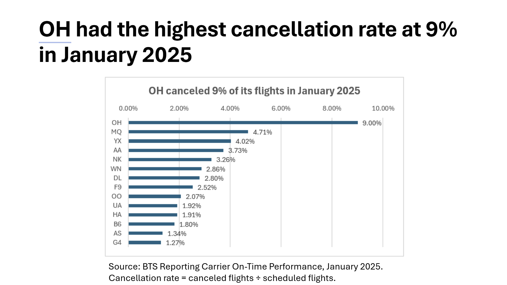
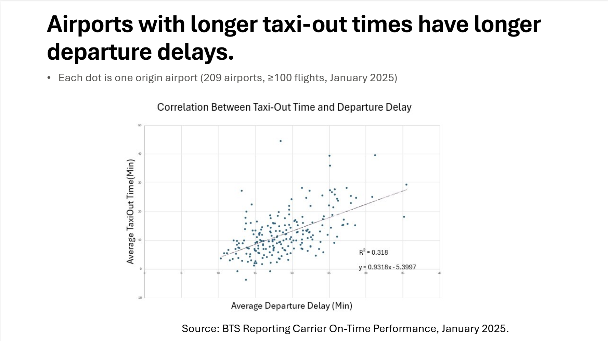
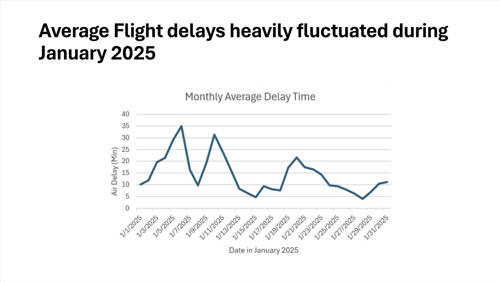

**Flight Delays and Cancellations** 

A Look at U.S. Airline Performance in January 2025 \
INEG 21003 \| Team 17 

Max Bassler: <https://basssler.github.io/quarto/> \
Caleb Clark: <https://kalev1olet.github.io/> \
Kaleb Rudolph: <https://kalebrudolph.github.io/> 

**Dataset** 

We used BTS Reporting Carrier On-Time Performance data for January 2025. Each row represents a domestic flight and includes information like the date, airline, airports, delays, cancellation status, taxi-out time, and distance. 

Dataset: <https://transtats.bts.gov/PREZIP/On_Time_Reporting_Carrier_On_Time_Performance_1987_present_2025_1.zip> 

**Airline Cancellation Rates** 

Our question was: Which airlines had the highest cancellation rates during January 2025? 

We wanted to compare cancellations because they can throw off an entire trip. We made a PivotTable in Excel with airlines as the rows and the cancellation indicator as the values. Canceled flights are marked 1 and other flights are marked 0, so taking the average gave us the cancellation rate. Using percentages let us compare airlines with different numbers of flights. 

We sorted the results from highest to lowest and made a horizontal bar chart with percentage labels. OH had the highest cancellation rate at 9.00%, while G4 had the lowest at 1.27%. The overall rate was 3.02%. These results only cover January 2025. 

**Taxi-Out Time and Departure Delay** 

Our question was: How were average taxi-out time and average departure delay related across airports during January 2025? 

We chose this because anyone who has waited on a runway has probably wondered how that time relates to flight delays. We made a PivotTable with origin airports as the rows and included the count of taxi-out times, average taxi-out time, and average departure delay. Excel excluded blank values from the averages. We kept airports with at least 100 recorded taxi-out times, leaving 209 airports. 

We copied the results as values and made a scatter plot with average departure delay on the horizontal axis and average taxi-out time on the vertical axis. Each dot represents one airport. We added axis titles, a linear trendline, and the R² value. 

The graph shows a positive relationship, with R² around 0.32. Airports with longer average taxi-out times tended to have longer average departure delays. This shows a relationship, but it does not prove one causes the other. 

**Daily Arrival Delays** 

Our question was: How did average arrival delay change throughout January 2025? 

We wanted to see whether certain days had longer delays than others. We made a PivotTable with flight dates as the rows and arrival delay minutes as the values. We changed the calculation from sum to average to get the average for each day. Excel excluded blank arrival delay values. 

We copied the results as values and made a line graph with dates on the horizontal axis and average arrival delay in minutes on the vertical axis. We simplified the date labels and added axis titles. 

January 6 had the highest average arrival delay at about 34.95 minutes, while January 28 had the lowest at about 4.07 minutes. The overall average was about 14.22 minutes. The arrival delay minutes field counts early arrivals as zero. 
